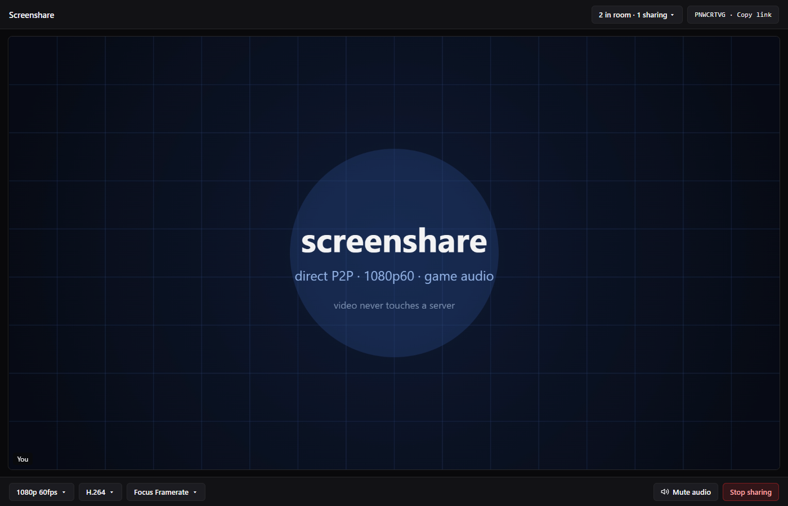

# screenshare

Low-latency screen sharing for a small group of friends, in the browser or the Windows
desktop app. One or more people share a screen with game audio; everyone else watches.
Rooms hold up to 20 people.

**Video never touches a server.** The Worker coordinates a few KB of signalling and then goes
quiet; media flows directly peer-to-peer via WebRTC.

[](https://screenshare.webmikas.com)

**Live:** [screenshare.webmikas.com](https://screenshare.webmikas.com)

## Requirements

- **Web:** Chrome or Edge on desktop. Only Chromium captures system/game audio and exposes
  the encoder controls (`jitterBufferTarget`, codec preferences) the app depends on.
- **Per-window audio on the web** needs Chrome or Edge 141+ (`windowAudio: "window"`).
- **macOS & Linux:** macOS Chrome captures tab audio only; Linux/Wayland has similar
  limits. Screen sharing works, system audio does not.
- **Desktop app (Windows):** Targets Windows x64; captures per-window process-tree audio or
  system audio via WASAPI loopback (`loopback-capture` + `koffi`), and automatically follows
  supported multi-window games (such as League of Legends) between lobby and match windows.
- **Development:** Node.js 22.18+ (`engines.node` in `package.json`), or `nix develop`.

## Desktop app (Windows)

Download the latest Windows x64 installer from
[GitHub Releases](https://github.com/mikaelsouza/screenshare/releases/latest):

- **`Screenshare-Setup-<version>.exe`** — assisted NSIS installer (defaults to a
  per-user install without admin rights, with an optional all-users mode and Start Menu
  / Desktop shortcuts). Checks GitHub Releases in the background and installs updates
  automatically when you close the app.

> **Windows SmartScreen & update verification:** Release binaries and background
> auto-updates are not Authenticode-signed yet, so Windows may prompt *"Windows protected
> your PC"* on first launch — click **More info** → **Run anyway**. Auto-updates verify the
> `SHA-512` digest in `latest.yml` from the GitHub Release; `SHA256SUMS.txt` is provided to
> verify download integrity against corrupted or truncated transfers.

## Quick start

```bash
nix develop             # Node 22, patchelf, Chromium, gh (optional)
npm install             # installs dependencies; patches workerd on NixOS
npm run dev             # frontend-only Vite server (no /api/room or /ws Worker proxy)
npm run preview         # built assets + Worker/RoomDO via wrangler dev (full room creation/joining)

# Desktop app (Electron)
npm run electron:dev    # Vite dev server + Electron app (frontend UI only without a Worker proxy)
npm run electron:start  # build assets; Electron loads the hosted site by default
npm run electron:pack   # unpacked directory build for the current host in release/
npm run electron:build  # Windows x64 NSIS installer in release/
```

Room creation (`/api/room`) and signalling (`/ws/:code`) require the Worker. Use
`npm run preview` for local browser testing with built assets, or set
`SCREENSHARE_URL=http://localhost:8787` when running Electron against `npm run preview`
(or proxy `/api/room` HTTP and `/ws` WebSocket requests from Vite to `wrangler dev`).

## How it works

```
Peer A ──┐                                    ┌── Peer B
         │  WebSocket (signalling only)       │
         └──►  Worker ──► RoomDO (per room) ◄─┘

Peer A ═════════ SRTP media + control DC, peer-to-peer ═════════ Peer B
```

- **Worker** (`worker/index.ts`, `worker/ratelimit.ts`, `worker/ipkey.ts`,
  `worker/upgrade.ts`) serves the frontend with strict security headers (CSP with
  `require-trusted-types-for 'script'` and `trusted-types 'none'`), hands out 8-character
  room codes at `/api/room`, and routes `/ws/:code` to a per-room Durable Object behind
  per-IP rate limits (keyed by IPv4 address or IPv6 `/64`).
- **RoomDO** (`worker/room.ts`) coordinates WebSocket Hibernation signalling (answering
  keepalive pings via `setWebSocketAutoResponse` without waking the object), room
  membership, in-place session resumption, and host moderation. It never parses SDP or sees
  media.
- **Shared protocol** (`shared/protocol.ts`) validates room codes, `/api/room` responses,
  and client/server WebSocket messages (capping SDP at 64 KB and ICE candidates at 1 KB)
  at runtime with Zod in `jitless` mode for Trusted Types CSP compatibility; P2P
  data-channel `view` control messages are validated with the same Zod instance in
  `src/mesh.ts`.
- **Frontend** (`src/`) handles capture (`src/capture.ts`), encoder/decoder tuning
  (`src/quality.ts` — `x-google-start-bitrate=6000` kbps, 48 kHz / 256 kbps stereo Opus,
  150 ms receiver `jitterBufferTarget`, and Chromium's built-in per-peer WebRTC congestion
  control), the partial WebRTC mesh with perfect negotiation and send-side pausing
  (`src/mesh.ts`), WebSocket reconnection (`src/signaling.ts`), `getStats()` link health
  (`src/stats.ts`), and pure UI state (`src/ui-model.ts`). Viewers connect only to sharers,
  never to each other.
- **Desktop app** (`electron/`, `src/platform/`) loads the hosted web app so desktop and
  browser users share rooms, adding a native window/screen picker (`electron/picker.ts`),
  WASAPI process-tree and system audio capture (`electron/audio/`,
  `src/platform/pcm-audio.ts`), automatic lobby-to-match window following
  (`electron/follow/`), and background GitHub Releases auto-updates (`electron/updater.ts`).

## Privacy

- **Peer-to-peer connections** are direct between peers using STUN
  (`stun:stun.cloudflare.com:3478`) for NAT traversal. Connections are opened only when at
  least one side is sharing; people in the room you connect with can see your IP address.
- **Room invites & URL privacy:** Creating a room (`POST /api/room`) atomically mints an
  8-character room code and a 16-character random invite secret (`CODE-SECRET`). Invite links
  place `#CODE-SECRET` solely in the URL fragment (never sent to HTTP servers or referrer
  logs), and the client immediately scrubs the address bar back to `/` while caching temporary
  rejoin state in `sessionStorage`. Raw `#CODE-SECRET` strings are kept in memory only, while
  room creation stores a bounded creator `hostToken` (up to 20 rooms, 90-day local expiry) in
  `localStorage` so creators keep host controls across sessions—note that a `hostToken` is a
  room-entry credential that can admit the creator and retrieve the current invite link, and can
  be cleared anytime via **Forget host on this device** (or **Forget saved host rooms on this
  device** in the lobby).
- **Host controls & moderation:** The room creator holds a cryptographic `hostToken`. The host
  can rotate the invite secret at any time, lock the room to new joins, or remove participants.
  Removing a participant revokes all pre-issued disconnected `rejoinToken` tickets across the
  room (while atomically re-issuing fresh tickets to remaining connected participants), bans
  their IPv4 address or IPv6 `/64` prefix for 15 minutes, and automatically rotates the room's
  invite secret (while locked, non-host peers never receive plaintext invite secrets). Active
  members keep their `rejoinToken` while connected and for up to 5 minutes after disconnecting
  (25 seconds across a manual rotation). If no host is present in an occupied room for 5 minutes,
  the earliest-joined active member is temporarily promoted for that session (memory-only, never
  saved to `localStorage`; occupied locked rooms never auto-unlock).
- **The server sees** your IPv4 address or IPv6 `/64` prefix, room code, display name,
  `hostToken`/`rejoinToken` values sent in `join` messages, salted SHA-256 hashes of room
  secrets/tokens, and (for the lifetime of the room) the active room invite secret (plus a
  temporary promoted `hostToken` until recovered on reconnect) so unlocked rooms and promoted
  hosts can continue sharing invites. Uninitialized room codes accept zero persistent writes, and
  stored ticket and ban maps are capped at 128 entries. Unused rooms that are never joined expire
  after **12 hours**. Once a room has been used and empties, ephemeral session state (rejoin
  tickets, kick-ban IPs, pending/session host promotions, and room locks) clears **15 minutes**
  after emptying—rotating the invite secret if the room was locked when emptied so pre-lock
  leaked links remain invalid, and restoring the creator's host authority—while room credentials
  remain reusable for **90 days** from the room creator's last activity (non-host visits do not
  extend the 90-day cap, and rotated or kicked secrets stay revoked).
- **Room chat** is relayed ephemerally in transit over the room's encrypted WebSocket (`wss://`)
  only to currently connected participants, with zero server storage or message history.

Known limitations and open defects are tracked in
[Issues](https://github.com/mikaelsouza/screenshare/issues).

## Audio & stream controls

Screen and window sharing always enables Chrome's native audio toggle: per-application
audio on the **Window** tab (`windowAudio: "window"`) and system audio (excluding this
browser's own playback via `restrictOwnAudio: true`) on the **Entire Screen** tab. Voice
DSP (`echoCancellation`, `noiseSuppression`, `autoGainControl`) is disabled and Opus is
configured for 48 kHz stereo at 256 kbps (`usedtx=0`). In the desktop app, WASAPI captures
the shared window's process tree (following games between lobby and match windows) or
system audio excluding the app itself. While streaming, the **Mute audio** button next to
**Stop sharing** mutes or unmutes your outbound audio track in place.

Sharers can switch quality presets (`1080p60` default, 12 Mbps max; `1080p30`, 8 Mbps max;
`720p60`, 8 Mbps max; `720p30`, 6 Mbps max), video codecs (`H.264` default, `AV1`), and
stream priority (`Focus Framerate` default for smooth FPS, or `Focus Clarity` for sharp
resolution) live without stopping the share, toggle their local preview tile, and view
per-viewer outbound bitrates in the room roster. Viewers get per-tile pause (which stops
the sharer's outbound video encoder for that link via a P2P data channel, alongside
automatic off-screen `IntersectionObserver` pausing), mute, volume boost up to 200% via
Web Audio (`GainNode` + `DynamicsCompressorNode`), Fit/Fill sizing, Focus (pin/spotlight),
Picture-in-Picture, live stats, and fullscreen controls.

## Deploy

1. Add a comma after `ratelimits`, uncomment `routes` in `wrangler.jsonc`, replace the
   `<tld>` placeholder with your custom domain, and configure `CLOUDFLARE_API_TOKEN` and
   `CLOUDFLARE_ACCOUNT_ID` in GitHub Actions repository secrets.
2. Push to `main` to deploy the web frontend and Worker.
   - `.github/workflows/deploy.yml` verifies that both `CI` and `CodeQL` succeeded for the
     `main` commit and deploys with `cloudflare/wrangler-action`. Existing desktop app installs
     pick up web/UI updates immediately because they load the hosted site.
   - `npm run deploy` builds and deploys the Worker locally without running any checks.
3. Release the Windows desktop app by pushing a `vMAJOR.MINOR.PATCH` tag on the target `main`
   commit (or manually dispatching `.github/workflows/release-electron.yml` for that commit).
   - The workflow verifies `CI` and `CodeQL` passed on `main` for that commit, builds the
     Windows installer with all 6 `@electron/fuses` burned, runs both unpackaged
     (`electron:smoke`) and packaged fuse/ASAR (`electron:smoke:packaged`) checks, attaches
     SLSA build provenance via `actions/attest-build-provenance`, and publishes the GitHub
     Release (`latest.yml`, `.blockmap`, and `SHA256SUMS.txt`).

## Development

```bash
npm run check                    # typecheck client, worker, and electron (TypeScript 7)
npm run lint:all                 # dead-code & cycle check (knip) + type-aware lint (oxlint)
npm run check:guardrails         # verify protected guardrail diff rules locally
npm run test:unit                # unit tests (protocol, mesh, quality, capture, audio, follow, UI)
npm run test:worker              # RoomDO in real workerd (@cloudflare/vitest-plugin)
npm run test:formal              # exhaustive & stateful model-based invariant suites
npm run test:fuzz                # fast-check property and fuzz tests
npm run test:mutate              # Stryker mutation testing
npm run test:e2e                 # Playwright Chromium peers: P2P media and edge cases
npm run test:e2e:impaired        # network-impaired E2E suite (tc netem + Playwright)
npm run electron:smoke           # Playwright smoke test for the unpackaged Electron app
npm run electron:smoke:packaged  # fuse/ASAR smoke test for the packaged Windows Electron build
npm test                         # check + lint:all + test:unit + test:worker
npm run test:all                 # test + test:formal + test:fuzz + test:e2e
```

Set `CHROMIUM_BIN` if you are not inside `nix develop` (on Windows, E2E tests fall back
to `C:\Program Files\Google\Chrome\Application\chrome.exe` when `CHROMIUM_BIN` is unset).

## AI Usage Alert

This project was made using autonomous AI agents that wrote, tested and reviewed the code.

<a href="https://0rwx.com/">
  
</a>

## License

[MIT](LICENSE) © Mikael Souza
