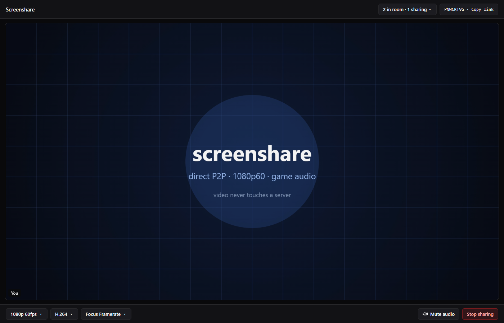

# screenshare

Low-latency screen sharing for a small group of friends, in the browser or the Windows
desktop app. One or more people share a screen with game audio; everyone else watches.
Rooms hold up to 20 people.

**Video never touches a server.** The Worker coordinates a few KB of signalling and then goes
quiet; media flows directly peer-to-peer via WebRTC.

[](https://screenshare.webmikas.com)

**Live:** [screenshare.webmikas.com](https://screenshare.webmikas.com)

## Requirements

- **Web:** Chrome or Edge on desktop. Only Chromium captures system/game audio and exposes
  the encoder controls (`jitterBufferTarget`, codec preferences) the app depends on.
- **Per-window audio on the web** needs Chrome or Edge 141+ (`windowAudio: "window"`).
- **macOS & Linux:** macOS Chrome captures tab audio only; Linux/Wayland has similar
  limits. Screen sharing works, system audio does not.
- **Desktop app (Windows):** Captures per-window process-tree audio or system audio via
  WASAPI loopback (`loopback-capture` + `koffi`), and automatically follows supported
  multi-window games (such as League of Legends) between lobby and match windows.

## Quick start

```bash
nix develop             # Node 22, patchelf, Chromium, gh (optional)
npm install             # installs dependencies; patches workerd on NixOS
npm run dev             # frontend-only Vite server (no /api/room or /ws Worker proxy)
npm run preview         # built assets + Worker/RoomDO via wrangler dev (full room creation/joining)

# Desktop app (Electron)
npm run electron:dev    # Vite dev server + Electron app (frontend UI only without a Worker proxy)
npm run electron:start  # build assets; Electron loads the hosted site by default
npm run electron:build  # Windows NSIS installer + portable exe in release/
```

Room creation (`/api/room`) and signalling (`/ws/:code`) require the Worker. Use
`npm run preview` for local browser testing with built assets, or set
`SCREENSHARE_URL=http://localhost:8787` when running Electron against `npm run preview`
(or proxy `/api/room` HTTP and `/ws` WebSocket requests from Vite to `wrangler dev`).

## How it works

```
Peer A ──┐                                    ┌── Peer B
         │  WebSocket (signalling only)       │
         └──►  Worker ──► RoomDO (per room) ◄─┘

Peer A ═════════ SRTP media + control DC, peer-to-peer ═════════ Peer B
```

- **Worker** (`worker/index.ts`, `worker/ratelimit.ts`, `worker/ipkey.ts`,
  `worker/upgrade.ts`) serves the frontend with strict security headers (CSP with
  `require-trusted-types-for 'script'` and `trusted-types 'none'`), hands out 8-character
  room codes at `/api/room`, and routes `/ws/:code` to a per-room Durable Object behind
  per-IP rate limits (keyed by IPv4 address or IPv6 `/64`).
- **RoomDO** (`worker/room.ts`) coordinates WebSocket Hibernation signalling, room
  membership, in-place session resumption, and host moderation. It never parses SDP or sees
  media.
- **Shared protocol** (`shared/protocol.ts`) validates room codes and all client/server
  WebSocket and P2P control messages at runtime with Zod (in `jitless` mode for Trusted
  Types CSP compatibility).
- **Frontend** (`src/`) handles capture (`src/capture.ts`), encoder/decoder tuning
  (`src/quality.ts`), the partial WebRTC mesh with perfect negotiation and send-side pausing
  (`src/mesh.ts`), WebSocket reconnection (`src/signaling.ts`), `getStats()` link health
  (`src/stats.ts`), and pure UI state (`src/ui-model.ts`). Viewers connect only to sharers,
  never to each other.
- **Desktop app** (`electron/`, `src/platform/`) loads the hosted web app so desktop and
  browser users share rooms, adding a native window/screen picker (`electron/picker.ts`),
  WASAPI process-tree and system audio capture (`electron/audio/`,
  `src/platform/pcm-audio.ts`), and automatic lobby-to-match window following
  (`electron/follow/`).

## Privacy

- **Peer-to-peer connections** are direct between peers using STUN
  (`stun:stun.cloudflare.com:3478`) for NAT traversal. Connections are opened only when at
  least one side is sharing; people in the room you connect with can see your IP address.
- **Host controls:** The join that creates a room becomes its host (`hostToken`). The host
  can remove people (revoking that session's `rejoinToken` and banning their IPv4 address
  or IPv6 `/64` for 15 minutes) or lock the room to new joins. Members receive a
  `rejoinToken` on welcome to resume in place on reconnect or rejoin past a lock; a valid
  `rejoinToken` also bypasses the IP ban (so other members sharing the address, or a member
  holding another valid session token, can still rejoin from that address). If the host
  leaves a locked room for 5 minutes, it unlocks automatically.
- **The server sees** your IP, the room code and your display name while you are connected.
  Room state and tokens are erased 12 hours after the room empties. A kicked member's IPv4
  address or IPv6 `/64` can remain stored after the 15-minute ban expires, until a later
  kick removes expired entries or room-state cleanup erases them.

Known limitations and open defects are tracked in
[Issues](https://github.com/mikaelsouza/screenshare/issues).

## Audio & stream controls

Screen and window sharing always enables Chrome's native audio toggle: per-application
audio on the **Window** tab (`windowAudio: "window"`) and system audio (excluding this
browser's own playback via `restrictOwnAudio: true`) on the **Entire Screen** tab. Voice
DSP (`echoCancellation`, `noiseSuppression`, `autoGainControl`) is disabled and Opus is
configured for 48 kHz stereo at 256 kbps (`usedtx=0`). In the desktop app, WASAPI captures
the shared window's process tree (following games between lobby and match windows) or
system audio excluding the app itself. While streaming, the **Mute audio** button next to
**Stop sharing** mutes or unmutes your outbound audio track in place.

Sharers can switch quality presets (`1080p60` at 8 Mbps default, `1080p30` at 6 Mbps,
`720p60` at 6 Mbps, `720p30` at 4 Mbps) and video codecs (`H.264` default, `VP9`, `AV1`,
`VP8`) live without stopping the share, toggle their local preview tile, and view
per-viewer outbound bitrates in the room roster. Viewers get per-tile pause (which stops
the sharer's outbound video encoder for that link via a P2P data channel, alongside
automatic off-screen `IntersectionObserver` pausing), mute, volume boost up to 200% via
Web Audio (`GainNode` + `DynamicsCompressorNode`), Fit/Fill sizing, Focus (pin/spotlight),
Picture-in-Picture, live stats, and fullscreen controls.

## Deploy

1. Set the custom domain in `routes` in `wrangler.jsonc` (replace the `<tld>` placeholder).
2. Push to `main`. `.github/workflows/deploy.yml` verifies that both `CI` and `CodeQL`
   succeeded for the commit and deploys with `cloudflare/wrangler-action`;
   `npm run deploy` builds and deploys locally without running any checks.

## Development

```bash
npm run check           # typecheck client, worker, and electron (TypeScript 7)
npm run lint:all        # dead-code & cycle check (knip) + type-aware lint (oxlint)
npm run test:unit       # unit tests (protocol, mesh, quality, capture, audio, follow, UI)
npm run test:worker     # RoomDO in real workerd (@cloudflare/vitest-plugin)
npm run test:formal     # formal state-machine & rate-limit invariant tests
npm run test:fuzz       # fast-check property and fuzz tests
npm run test:mutate     # Stryker mutation testing
npm run test:e2e        # Playwright Chromium peers: P2P media and edge cases
npm run electron:smoke  # Playwright smoke test for the Electron app
npm test                # check + lint:all + test:unit + test:worker
npm run test:all        # test + test:formal + test:fuzz + test:e2e
```

Set `CHROMIUM_BIN` if you are not inside `nix develop`.

## AI Usage Alert

This project was made using autonomous AI agents that wrote, tested and reviewed the code.

<a href="https://0rwx.com/">
  
</a>

## License

[MIT](LICENSE) © Mikael Souza
